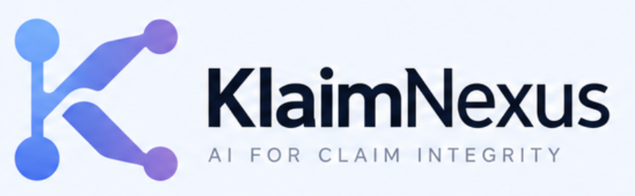
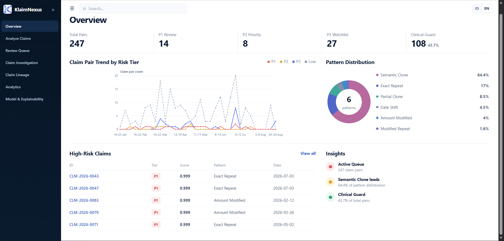
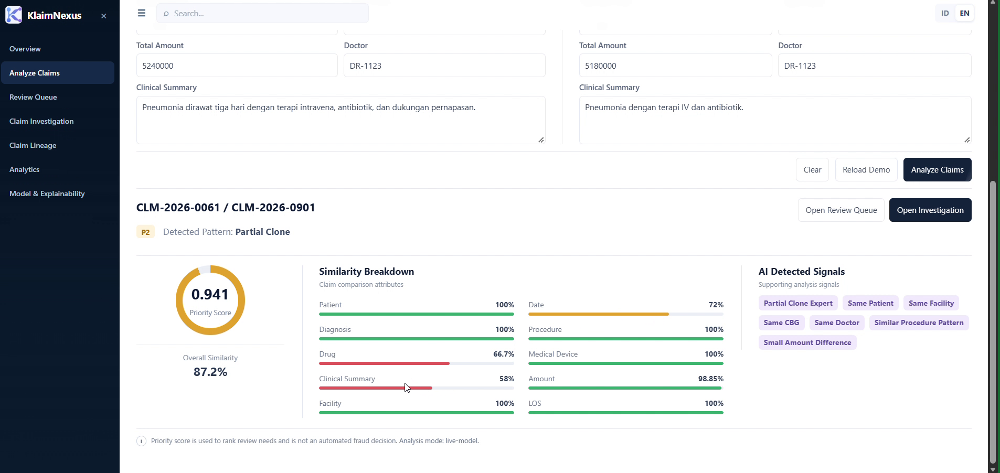
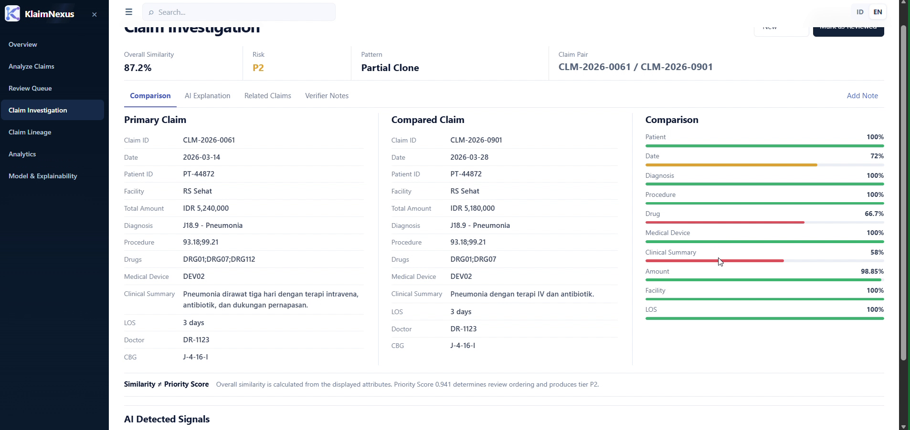
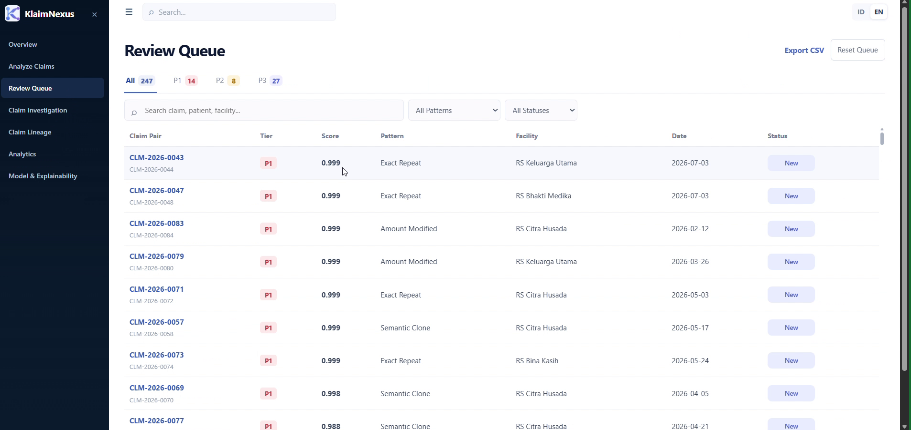
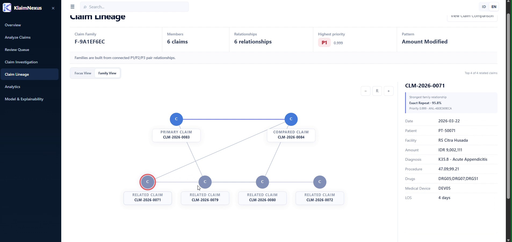

  

<h1 align="center">KlaimNexus</h1>

<strong>AI for Claim Integrity</strong>

Detect → Explain → Investigate

  
  
  
  
  

  <a href="assets/demo/KlaimNexus_Demo_720p.mp4"><strong>▶ Watch Product Demo</strong></a>
  &nbsp;·&nbsp;
  <a href="assets/screenshots/00_overview_dashboard.png"><strong>Open Overview Screenshot</strong></a>

  

KlaimNexus overview dashboard — click the preview to open the demo video.

> **Portfolio Showcase** — This public repository presents the product, architecture, evaluation summary, and prototype UI of KlaimNexus. The complete implementation, model artifacts, training pipeline, datasets, and internal experiment files are intentionally not published.

## Overview

**KlaimNexus** is an AI-assisted claim investigation prototype designed to help verifiers and auditors identify highly similar claim patterns, prioritize cases for review, explain *why* claims look related, and explore wider relationships through **Claim Family** and **Claim Lineage**.

The project focuses on patterns such as **Repeat Billing** and **Claim Cloning**, while explicitly avoiding the assumption that a highly similar claim is automatically fraudulent.

KlaimNexus is positioned as a **decision-support system**:

- **Detect** potentially relevant claim relationships;
- **Explain** similarity and review signals;
- **Investigate** individual pairs and connected claim families;
- keep the **final decision with a human verifier**.

## Demo

A compressed 720p walkthrough is included for convenient GitHub viewing:

- **[Watch KlaimNexus Product Demo](assets/demo/KlaimNexus_Demo_720p.mp4)**
- **[Open the Overview Dashboard](assets/screenshots/00_overview_dashboard.png)**

The demo shows the working prototype flow across claim analysis, review prioritization, investigation, analytics, and Claim Lineage.

## The problem

Repeat/cloning patterns are not always exact duplicates. A claim may preserve most of its clinical structure while changing a date, amount, medication, device, procedure, or narrative text.

At the same time, legitimate claims can also look highly similar — for example clinical look-alikes, readmissions, or standardized treatment patterns.

This creates a more useful question than simply *“Are these claims the same?”*:

> **Which claim relationships deserve review first, what evidence caused the signal, and are they part of a wider pattern?**

## Core capabilities

| Capability | What it does |
|---|---|
| **Compare 2 Claims** | Ad-hoc comparison of two claim records with similarity breakdown and review-priority context. |
| **Batch Analysis** | Validates CSV/XLSX claim data, generates candidate pairs, analyzes similarity, and builds a prioritized review workspace. |
| **Clinical Similarity Guard** | Adds protection against treating legitimate clinical similarity as automatically suspicious. |
| **Review Queue** | Organizes claim pairs into P1/P2/P3/Low review priority with workflow status. |
| **Claim Investigation** | Shows side-by-side claim attributes, similarity evidence, detected signals, and verifier notes. |
| **Claim Family** | Groups connected pair relationships into a wider investigation context. |
| **Claim Lineage** | Visualizes relationships among claims and contextual entities to support pattern exploration. |
| **Analytics & Explainability** | Presents model/evaluation context, risk trends, pattern distribution, and explainable signals. |

## How it works

```mermaid
flowchart LR
    A[Claim Dataset] --> B[Validation]
    B --> C[Candidate Pair Generation]
    C --> D[Similarity Analysis]
    D --> E[Clinical Similarity Guard]
    E --> F[Priority Scoring]
    F --> G[P1 / P2 / P3 / Low]
    G --> H[Review Queue]
    H --> I[Investigation]
    I --> J[Claim Family & Lineage]
    J --> K[Human Decision]
```

### Similarity ≠ priority

KlaimNexus keeps two concepts separate:

- **Overall Similarity** — how similar two claims appear across selected attributes.
- **Priority Score** — how strongly a claim pair should be prioritized for human review.

A high similarity score is **not** a fraud probability.

## Prototype screens

### Explainable claim comparison

  

The result combines review priority, overall similarity, attribute-level similarity, and detected signals so a reviewer can understand *why* the pair was surfaced.

### Claim investigation

  

A side-by-side investigation view exposes claim context such as patient, facility, date, diagnosis, procedure, drugs, medical device, amount, LOS, CBG, doctor, and clinical summary.

### Review queue

  

Priority tier and workflow status are intentionally separate. A pair can move through **New → In Review → Reviewed / Escalated** without the system declaring a fraud verdict.

### Claim Family & Lineage

  

Pair-level analysis can be expanded into a family-level view so investigators can understand connected claim relationships instead of repeatedly reviewing isolated pairs.

## ML evaluation snapshot

The v0.7.1 experimental pipeline was evaluated internally on **synthetic prototype data**.

| Metric | Result |
|---|---:|
| PR-AUC | **0.7766** |
| Hard-positive AP | **0.5766** |
| P3 Precision | **88.48%** |
| P3 Recall | **51.68%** |
| P3 Hard-positive Recall | **31.64%** |
| Clinical look-alike FPR (P3) | **4.36%** |
| Legitimate readmission FPR (P3) | **3.64%** |

The model is stronger on explicit **Exact Repeat** and **Modified Repeat** patterns and remains more challenging on subtle cloning variants. These results are **not production BPJS Kesehatan performance** and require domain validation on authorized real-world data before operational use.

See [`docs/MODEL_CARD.md`](docs/MODEL_CARD.md) for details.

## Technology

| Layer | Prototype technology |
|---|---|
| Backend | Python, Flask |
| Frontend | HTML, CSS, Vanilla JavaScript |
| Workflow storage | SQLite |
| Data processing | pandas, NumPy |
| ML experimentation | scikit-learn |
| Input | Manual claim pair, CSV/XLSX batch |

See [`docs/ARCHITECTURE.md`](docs/ARCHITECTURE.md) for the technical overview.

## Human-in-the-loop by design

KlaimNexus provides:

**priority · similarity · pattern · evidence · context**

The verifier remains responsible for:

**review · interpretation · escalation · final decision**

This separation is central to the product design because claim similarity alone is not sufficient evidence of misconduct.

## Privacy & governance

The portfolio and prototype use **synthetic/anonymized data**. No real JKN participant data is published in this repository.

The production roadmap considers data minimization, pseudonymization, access control, encryption, audit trails, model monitoring, threshold validation, and reviewer feedback.

See [`docs/PRIVACY_AND_GOVERNANCE.md`](docs/PRIVACY_AND_GOVERNANCE.md).

## Project maturity & roadmap

**Current:** Prototype

1. **Prototype** — similarity analysis, review workflow, investigation, Claim Family, Claim Lineage, analytics.
2. **Domain Validation** — feature review, threshold calibration, verifier/domain-expert feedback.
3. **Controlled Pilot** — authorized/anonymized real-world data, usability and scalability evaluation.
4. **Production Readiness** — scalable services, RBAC, audit logging, monitoring, security hardening, model governance.

## Team

| Member | Project role | Focus |
|---|---|---|
| **Akhmad Syaifudin** | Product Lead & Machine Learning Engineer | Product workflow, similarity/ML experimentation, model evaluation, prototype integration. |
| **Bagas Ilham Sanjaya** | Backend & Data Engineer | Data pipeline, backend/API, batch-analysis workflow, data integration. |
| **Alief Dzulfikar** | Frontend, UI/UX & Documentation | Interface implementation, investigation/lineage visualization, documentation and presentation assets. |

> Roles above describe responsibilities within this prototype project, not external professional titles.

## Repository scope

To protect project IP, this public repository does **not** include the reusable implementation or research artifacts required to reproduce the full system.

Not published:

- application/backend source code;
- full frontend source;
- similarity and priority-scoring implementation;
- trained model binaries;
- feature/model configuration artifacts;
- training/inference notebooks;
- raw/interim/processed datasets;
- internal experiment reports and threshold-search outputs;
- SQLite application state;
- private development Git history.

A guided demo or selected code review can be provided privately when appropriate.

See [`docs/PORTFOLIO_SCOPE.md`](docs/PORTFOLIO_SCOPE.md).

## Disclaimer

KlaimNexus is a research/prototype decision-support project. It does not provide a fraud verdict, medical diagnosis, claim rejection decision, or production BPJS Kesehatan determination.

## Copyright

**© 2026 Akhmad Syaifudin and the KlaimNexus project team. All rights reserved.**

This repository is **not open source**. No open-source license is granted. See [`NOTICE.md`](NOTICE.md).
