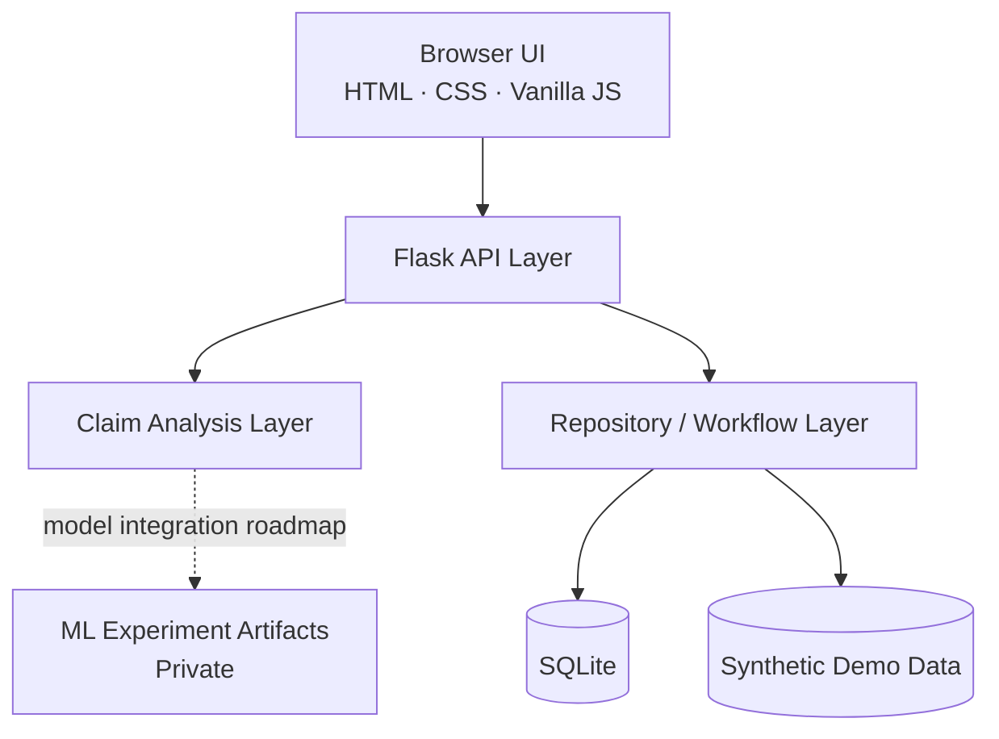

# KlaimNexus — Technical Architecture Overview

> Public portfolio document. Implementation details and proprietary source are intentionally omitted.

## Product flow

## Prototype application layers

## Runtime stack

- **Backend:** Python, Flask
- **Frontend:** HTML, CSS, Vanilla JavaScript
- **Workflow storage:** SQLite
- **Data/ML experimentation:** pandas, NumPy, scikit-learn
- **Input modes:** manual claim-pair comparison and CSV/XLSX batch analysis

## Design principles

### 1. Similarity is not a fraud probability
KlaimNexus separates **overall similarity** from **review priority**. High similarity can arise from legitimate clinical patterns, so the system is designed to support investigation rather than make an automatic fraud verdict.

### 2. Pair scoring + family-level investigation
The analytical unit is a claim pair. After pair-level analysis, connected relationships can be grouped into a **Claim Family** and visualized through **Claim Lineage**, allowing an investigator to move from a single pair to a wider pattern.

### 3. Human-in-the-loop
Priority tiers and detected signals are review aids. The verifier remains responsible for interpretation, escalation, and final decisions.

## Scalability roadmap

The prototype does not claim production-scale all-pairs comparison. Planned scaling approaches include:

- blocking and smarter candidate generation;
- approximate nearest-neighbor retrieval;
- indexed storage;
- asynchronous batch processing;
- separation of analysis/model services;
- monitoring and model-governance controls.
